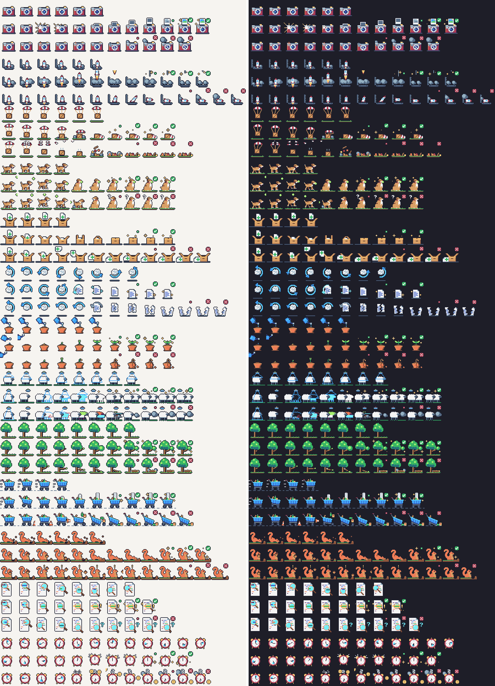

# tern-git-fx

[](https://github.com/willstarnet/tern-git-fx/actions/workflows/ci.yml)
[](LICENSE)

A [Tern](https://docs.stencil.so/tern/) plugin that plays a small pixel-art animation in the
corner of the terminal pane while a git command runs, then a success or failure ending by its
exit status. The overlay is CSS only: it never types into, reads or blocks the terminal.



| Command | Scene |
|---|---|
| `git commit` | An instant camera takes a snapshot: the print develops, or the flash fizzles and the lens cracks |
| `git push` | A rocket idles on its pad, then lifts off, or sputters and tips over |
| `git pull` | A crate under a parachute lands, or the chute rips and the crate smashes |
| `git fetch` | A dog runs, catches the ball, or watches it sail past |
| `git add` | A page bobs over an open box, drops in as the flaps close, or bounces off the rim |
| `git restore` | A rewind arrow circles a crumpled page that smooths out, or tears |
| `git init` | A watering can over a pot; a sprout unfurls, or wilts as the pot cracks |
| `git clone` | A scanner copies a sheep, or the copy glitches into smoke |
| `git branch` | A tree grows a new limb that buds, or cracks and falls |
| `git checkout` / `git switch` | A shopping cart rolls up and prints a receipt, or hits a cone and loses a wheel |
| `git stash` | A squirrel digs and buries an acorn, or watches it bounce away |
| `git blame` | A magnifying glass sweeps the code and finds the line, or comes up empty |
| `git reset` | A clock spins backwards and lands on 12, or springs pop out |

## Install

```sh
tern plugin install github.com/willstarnet/tern-git-fx           # install
tern plugin install github.com/willstarnet/tern-git-fx --force   # update
tern plugin remove tern-git-fx                                   # uninstall
```

To run a local checkout instead, `tern plugin link <dir>` uses it in place (saving a file reloads
it) and `tern plugin unlink tern-git-fx` undoes that. Requires Tern 0.8.3 or later. Removing the
plugin keeps its data folder (the toggle state and your `config.json`, see
[Configuration](#configuration)); delete that folder too if you want it gone.

## How it plays

- Command events come from the shell's OSC 133 integration, which Tern's shells have. A pane
  without it (a plain `ssh` session to a host without the integration) shows nothing.
- A command must run for `loop_delay_ms` (300 ms) before its loop shows; faster ones (`git add`,
  `git branch`) play only the ending. The ending's last frame stays up for `hold_ms` (900 ms).
- Only the focused pane can be drawn: Tern's DOM carries no pane ids, so the overlay follows
  focus. A command running in another pane shows its loop when you focus that pane; an ending
  shows only if its pane has focus when the command finishes, and is dropped when you leave.
- `git commit` with an editor and `git blame` with a pager count as running until you close them,
  so the loop plays meanwhile. Switch either off in the config if that bothers you.
- Under reduced motion (Tern's setting or the system's) the overlay is hidden.
- The sprite is drawn on the pane's `div.tv-layer::before`, with `pointer-events: none`;
  other plugins that decorate panes through different pseudo-elements are unaffected.

### What counts as a git command

- `git <command>` with any global options first (`git -C ../repo push`, `git -c k=v commit`,
  `git --no-pager blame`), any program path (`/usr/bin/git`), leading `VAR=value` assignments and
  wrappers (`sudo`, `env`, `command`, `time`, `nice`, `nohup`, `noglob`, ...).
- `git switch` animates as checkout and `git stage` as add.
- In a list or pipeline the last git command wins: `git add -A && git commit -m x && git push`
  shows the rocket. Quoted text is never parsed (`git commit -m "then git push"` is a commit).
- Aliases: the [oh-my-zsh git plugin](https://github.com/ohmyzsh/ohmyzsh/tree/master/plugins/git)
  ones (`gp`, `gco`, `gcmsg`, `gl`, `gsta`, `grhh`, ... see `fx/classify.luau`), `g` for `git`,
  and the git config shorthands `co`, `ci`, `br`, `sw`, `cl`, `rs`. Add your own in the config.

## Palette

| Command | Keys | Does |
|---|---|---|
| Toggle git animations | `ctrl+alt+cmd+g` | Turns the animations off or on in every window; remembered across restarts |
| Open git animations config | | Opens `config.json`, creating it with every default spelled out |

Rebind the toggle with a `keybinds` entry for action `plugin.tern-git-fx.toggle`.

## Configuration

`<tern data>/plugin-data/tern-git-fx/config.json`; on macOS
`~/Library/Application Support/tern/plugin-data/tern-git-fx/config.json`. Every key is optional;
an invalid one falls back to its default and the next command you run shows a toast naming it.
Changes apply to the next command (the file is read at most every 2 s).

```json
{
  "position": "bottom-right",
  "offset_px": 20,
  "scale": 3,
  "loop_delay_ms": 300,
  "hold_ms": 900,
  "commands": { "blame": false },
  "aliases": { "ship": "push", "gcm": "commit", "gp": false },
  "git_aliases": { "save": "commit" }
}
```

| Key | Default | Meaning |
|---|---|---|
| `position` | `"bottom-right"` | Pane corner: `top-right`, `top-left`, `bottom-right`, `bottom-left` |
| `offset_px` | `20` | Gap from the corner's two edges, CSS px (0-400) |
| `scale` | `3` | Integer upscale of the 32 px sprites (1-8) |
| `loop_delay_ms` | `300` | How long a command runs before its loop shows (0-10000) |
| `hold_ms` | `900` | How long the ending's last frame stays (0-10000) |
| `commands` | all `true` | Per-command switch, keyed by command name |
| `aliases` | oh-my-zsh set | Extra shell aliases or functions: name to command; `false` removes a built-in one |
| `git_aliases` | `co ci br sw cl rs` | Extra `git <alias>` names, same rules |

## Privacy

- The command line is reduced to a command name inside the event handler and dropped; it is
  never stored, logged or sent anywhere.
- No network requests and no processes. The only state is the toggle (`tern.kv`) and your
  `config.json`, both in the plugin's data folder.

## Development

```sh
bash scripts/setup.sh    # pinned lune, stylua, selene, luau-lsp into .tools/bin; Tern API types
bash scripts/check.sh    # format, lint, types, unit tests, sprite rebuild check
```

| Path | Role |
|---|---|
| `window.luau` | Window entry: Tern events, palette commands, config file, toggle |
| `fx/classify.luau` | Command line to git command, aliases |
| `fx/config.luau` | config.json schema, validation, starter file |
| `fx/player.luau` | Per-pane state machine: pending, loop, ending, cleared; focus handling |
| `fx/css.luau` | The overlay sheet for one animation |
| `fx/sprites.luau` | Manifest and sheet loading, validation, data URLs |
| `tools/art/` | Procedural pixel art; `tools/build_sprites.py` builds `assets/sprites/` ([docs/sprites.md](docs/sprites.md)) |

[CONTRIBUTING.md](CONTRIBUTING.md) covers setup, the sandboxed dev loop, tests and pull requests.

## Contributing and support

Bug reports, ideas and pull requests are welcome: read [CONTRIBUTING.md](CONTRIBUTING.md) first.
Questions go where [SUPPORT.md](SUPPORT.md) says; report vulnerabilities privately as described
in [SECURITY.md](SECURITY.md). Everyone taking part follows the
[Code of Conduct](CODE_OF_CONDUCT.md). Changes are listed in [CHANGELOG.md](CHANGELOG.md).

## License

[MIT](LICENSE), code and art alike: the sprites are generated by the code in `tools/art/`. The
palette is Sweetie 16 by GrafxKid.
